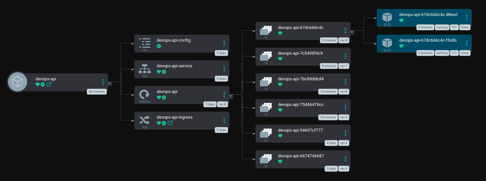
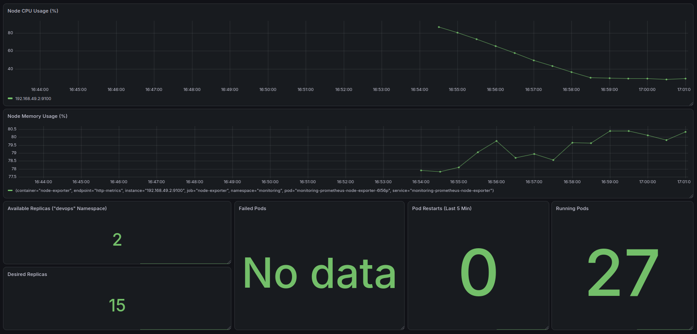

# Kubernetes DevOps Platform

A hands-on DevOps platform that takes a containerized Python API from source code to a running, monitored Kubernetes deployment using **Docker**, **Helm**, **ArgoCD (GitOps)**, **Prometheus** and **Grafana**.

[](https://www.python.org/) [](https://www.docker.com/) [](https://kubernetes.io/) [](https://helm.sh/) [](https://argo-cd.readthedocs.io/) [](https://prometheus.io/) [](https://grafana.com/)

## Table of Contents

- [Overview](#overview)
- [Architecture](#architecture)
- [Tech Stack](#tech-stack)
- [Project Structure](#project-structure)
- [Prerequisites](#prerequisites)
- [Getting Started](#getting-started)
  - [1. Run the app locally](#1-run-the-app-locally)
  - [2. Build the Docker image](#2-build-the-docker-image)
  - [3. Deploy with raw Kubernetes manifests](#3-deploy-with-raw-kubernetes-manifests)
  - [4. Deploy with Helm](#4-deploy-with-helm)
  - [5. Deploy with ArgoCD (GitOps)](#5-deploy-with-argocd-gitops)
- [Monitoring and Alerting](#monitoring-and-alerting)
- [Testing](#testing)
- [Configuration](#configuration)
- [Roadmap](#roadmap)
- [License](#license)

## Overview

This project demonstrates an end-to-end DevOps workflow:

1. A small Python API (`app/`) with unit tests.
2. A `Dockerfile` that packages the app into a container image.
3. Plain Kubernetes manifests (`k8s-manifests/`) for simple deployments.
4. A Helm chart (`helm/devops-api/`) for templated, configurable deployments.
5. ArgoCD (`argocd-config/`) which keeps the cluster in sync with this Git repository (GitOps).
6. A monitoring stack (`helm/monitoring/`) with Prometheus alert rules and a Grafana dashboard.

## Architecture

The diagram below is the live ArgoCD view of the `devops-api` application. It shows every Kubernetes resource ArgoCD manages from this repository, all healthy and in sync.



**What the diagram shows:**

| Resource | Name | Purpose |
|----------|------|---------|
| Application | `devops-api` | ArgoCD application that syncs this repo to the cluster |
| ConfigMap | `devops-api-config` | Application configuration |
| Service | `devops-api-service` | Internal load balancing for the pods |
| Ingress | `devops-api-ingress` | External HTTP access to the API |
| Deployment | `devops-api` | Manages rollouts and keeps the desired number of pods running |
| ReplicaSets | `devops-api-*` | One per revision, which keeps rollout history and enables rollback |
| Pods | `devops-api-*` | Two running replicas (`1/1` ready) |

**Flow:**

1. A developer pushes code or manifest changes to Git.
2. ArgoCD detects the change in the repository.
3. ArgoCD syncs the Helm chart to the Kubernetes cluster.
4. The Deployment creates a new ReplicaSet and rolls out new pods.
5. The application is exposed through the Service and Ingress.
6. Prometheus scrapes metrics and Grafana visualizes them.

## Tech Stack

| Area | Tools |
|------|-------|
| Application | [](https://www.python.org/) [](https://pytest.org/) |
| Containerization | [](https://www.docker.com/) |
| Orchestration | [](https://kubernetes.io/) |
| Packaging | [](https://helm.sh/) |
| GitOps / CD | [](https://argo-cd.readthedocs.io/) |
| Monitoring | [](https://prometheus.io/) [](https://grafana.com/) |

## Project Structure

```
.
├── app/                        # Python application
│   ├── app.py                  # Application entrypoint
│   ├── requirements.txt        # Python dependencies
│   └── tests/
│       └── test_app.py         # Unit tests
├── argocd-config/
│   └── devops-api.yaml         # ArgoCD Application definition
├── docs/
│   └── images/                 # README images
│       ├── argocd-devops-architecture.png
│       └── grafana-dashboard.png
├── helm/
│   ├── devops-api/             # Helm chart for the application
│   │   ├── Chart.yaml
│   │   ├── values.yaml
│   │   └── templates/
│   │       ├── configmap.yaml
│   │       ├── deployment.yaml
│   │       ├── ingress.yaml
│   │       └── service.yaml
│   └── monitoring/             # Monitoring configuration
│       ├── values.yaml
│       ├── prometheus/
│       │   └── alerts.yaml     # Prometheus alert rules
│       └── grafana/
│           └── dashboards/
│               └── kubernetes-cluster.json
├── k8s-manifests/              # Plain Kubernetes manifests
│   ├── namespace.yaml
│   ├── configmap.yaml
│   ├── deployment.yaml
│   ├── service.yaml
│   └── ingress.yaml
├── Dockerfile                  # Container image definition
├── install_argocd.sh           # Script to install ArgoCD
└── README.md
```

## Prerequisites

- [Docker](https://docs.docker.com/get-docker/)
- A Kubernetes cluster (e.g. [minikube](https://minikube.sigs.k8s.io/), [kind](https://kind.sigs.k8s.io/), or a cloud cluster)
- [kubectl](https://kubernetes.io/docs/tasks/tools/)
- [Helm 3](https://helm.sh/docs/intro/install/)
- Python 3.10+ (for local development and tests)
- An Ingress controller (e.g. NGINX Ingress) if you want to use the Ingress resource

## Getting Started

Clone the repository:

```bash
git clone https://github.com/Vatcharadze/kubernetes-devops-platform.git
cd kubernetes-devops-platform
```

### 1. Run the app locally

```bash
cd app
python -m venv venv
source venv/bin/activate        # Windows: venv\Scripts\activate
pip install -r requirements.txt
python app.py
```

### 2. Build the Docker image

```bash
docker build -t devops-api:latest .
docker run -p 5000:5000 devops-api:latest
```

> Adjust the port to match the one your application listens on.

If you use minikube, load the image into the cluster:

```bash
minikube image load devops-api:latest
```

### 3. Deploy with raw Kubernetes manifests

```bash
kubectl apply -f k8s-manifests/namespace.yaml
kubectl apply -f k8s-manifests/
kubectl get all -n <namespace>
```

### 4. Deploy with Helm

```bash
helm install devops-api ./helm/devops-api -n <namespace> --create-namespace
helm list -n <namespace>
```

Override values at install time:

```bash
helm upgrade --install devops-api ./helm/devops-api \
  -n <namespace> \
  --set image.tag=latest
```

### 5. Deploy with ArgoCD (GitOps)

Install ArgoCD using the provided script:

```bash
chmod +x install_argocd.sh
./install_argocd.sh
```

Access the ArgoCD UI:

```bash
kubectl port-forward svc/argocd-server -n argocd 8080:443
```

Open <https://localhost:8080>. Get the initial admin password:

```bash
kubectl -n argocd get secret argocd-initial-admin-secret \
  -o jsonpath="{.data.password}" | base64 -d
```

Register the application:

```bash
kubectl apply -f argocd-config/devops-api.yaml
```

From now on, any change pushed to this repository is automatically synced to the cluster by ArgoCD.

## Monitoring and Alerting

The `helm/monitoring/` directory contains:

- **Prometheus alert rules** in `prometheus/alerts.yaml`
- **Grafana dashboard** in `grafana/dashboards/kubernetes-cluster.json`
- **Helm values** in `values.yaml`

Example installation using the `kube-prometheus-stack` chart:

```bash
helm repo add prometheus-community https://prometheus-community.github.io/helm-charts
helm repo update

helm install monitoring prometheus-community/kube-prometheus-stack \
  -n monitoring --create-namespace \
  -f helm/monitoring/values.yaml
```

Access Grafana:

```bash
kubectl port-forward svc/monitoring-grafana -n monitoring 3000:80
```

Open <http://localhost:3000> and import `kubernetes-cluster.json` if it is not provisioned automatically.

### Grafana Dashboard



## Testing

Run unit tests from the `app` directory:

```bash
cd app
pip install -r requirements.txt
pytest tests/
```

## Configuration

Application settings are managed through a Kubernetes **ConfigMap**:

- Raw manifests: `k8s-manifests/configmap.yaml`
- Helm chart: `helm/devops-api/templates/configmap.yaml`

Chart settings (image, replicas, service, ingress, resources) live in `helm/devops-api/values.yaml`.


## Author

Created by **Davit Vatcharadze** ([@Vatcharadze](https://github.com/Vatcharadze)).
